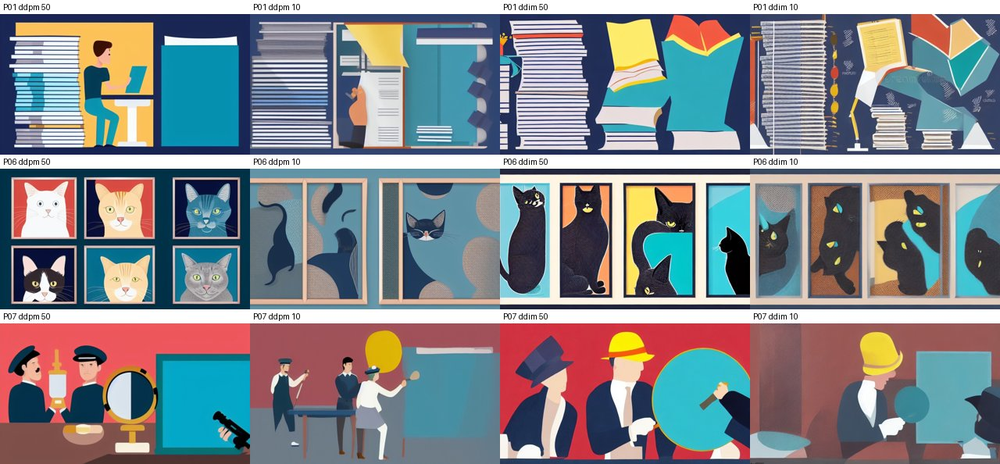
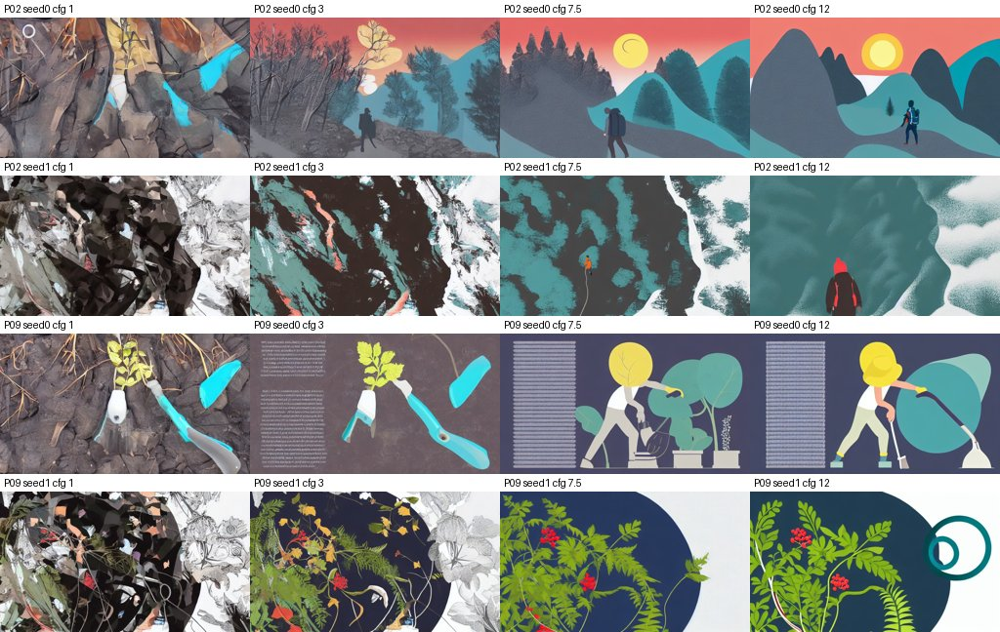
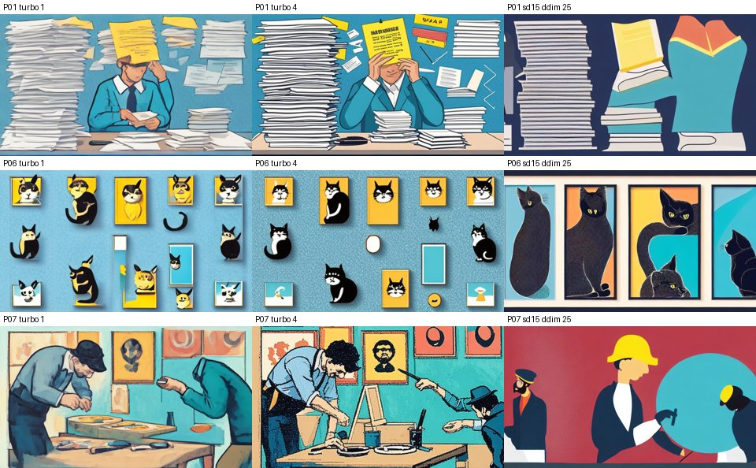
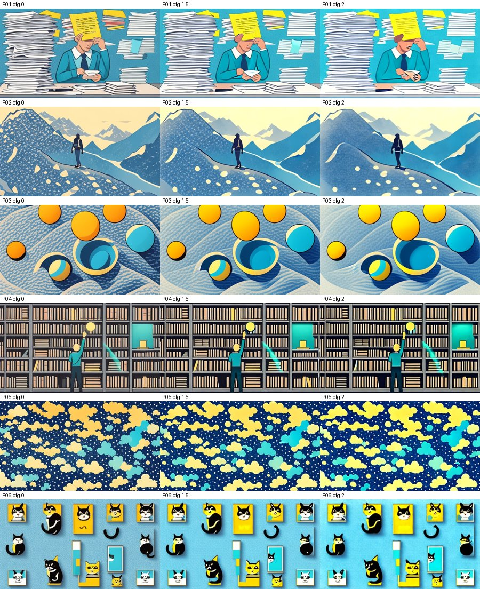
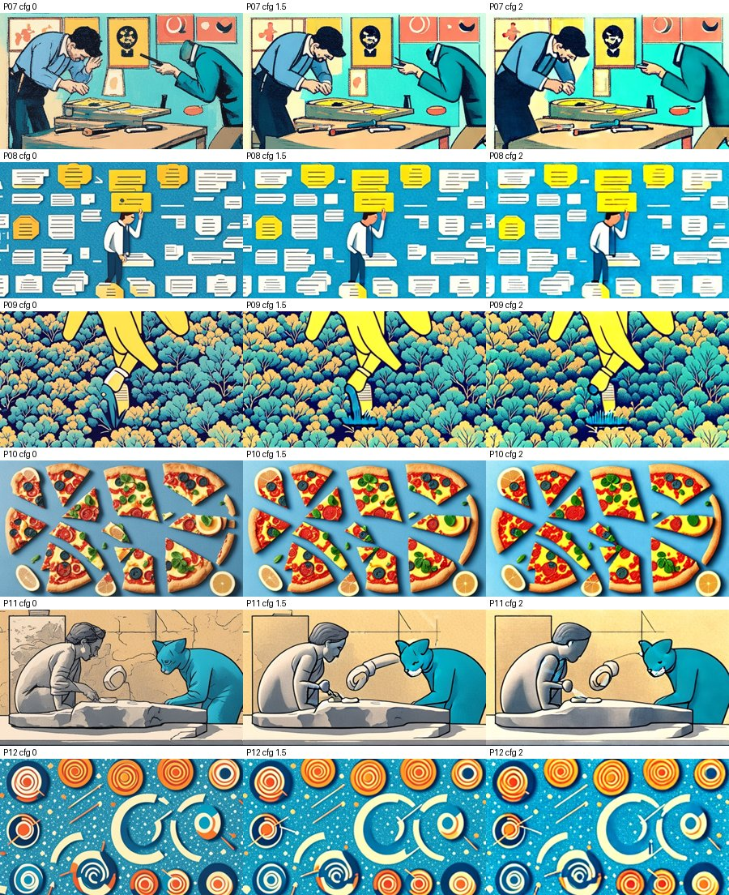
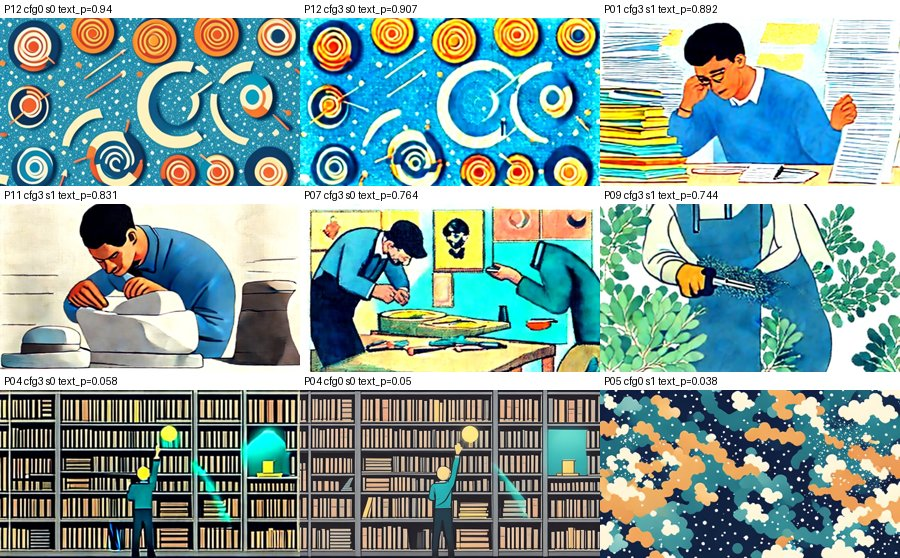
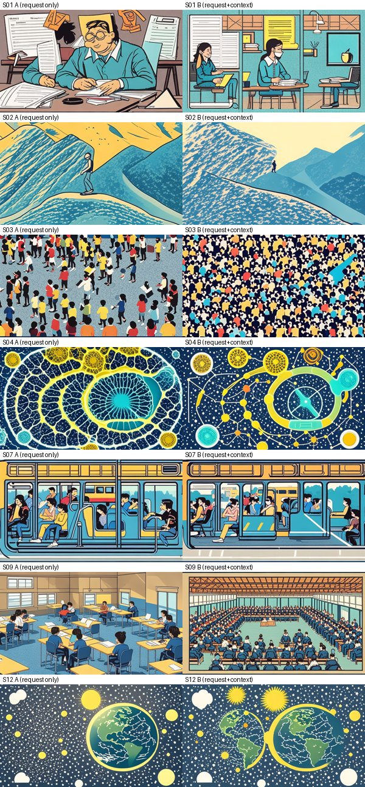
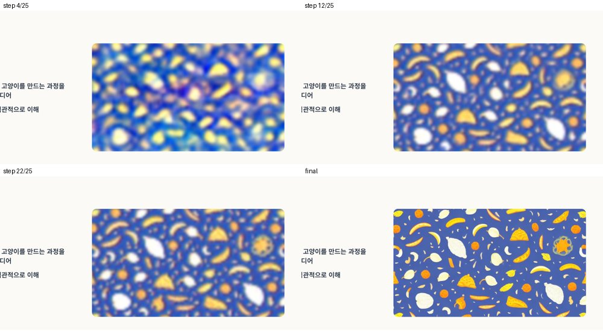

# 확산 모델 비교 실험 (X1~X5)

실험일: 2026-11-17. 장치: Apple M5, 메모리 16GB, MPS, PyTorch 2.15, diffusers 0.43. **모두 로컬 실행이라 API 비용은 0입니다.**

## 목적

NextSlide의 이미지 생성 단계를 공개 확산 모델로 바꾸고, 강의에서 다룬 샘플링·가이던스 설정이 **슬라이드용 그림의 속도와 품질**을 어떻게 바꾸는지 한 번에 하나씩 비교합니다(17강 29쪽 “Change one setting at a time”).

## 공통 조건

- **장면**: 강의 비유 장면 12개([eval/diffusion/prompts.json](../eval/diffusion/prompts.json)). 개발자가 직접 썼고, 기획 LLM 출력이 아닙니다.
- **프롬프트**: 시스템과 같은 방식으로 만듭니다.
  - 장면을 앞에 두고 짧은 화풍 문구를 붙입니다. CLIP 텍스트 인코더의 77토큰 한도 때문입니다.
  - CFG를 쓰는 경우에만 “글자 금지” negative prompt를 넣습니다.
- **시드**: 장면마다 0과 1. 같은 시드는 같은 초기 잡음이므로, 조건만 바뀝니다.
- **해상도**: 768×432(16:9). 잠재 공간은 96×54입니다.
- **지표**
  - **시간**: 파이프라인 호출 전후 단조 시계, GPU 동기화 후. 첫 호출은 워밍업이라 제외.
  - **CLIP 유사도**: `openai/clip-vit-base-patch32`로 계산한 이미지와 장면 문장의 코사인 × 100. 생성 모델의 텍스트 인코더(SD 1.5: ViT-L/14, SD-Turbo: OpenCLIP ViT-H)와 다른 모델을 씁니다. 95% 구간은 장면 12개를 부트스트랩해서 구했습니다.
  - **다양성**: 같은 장면·조건에서 시드 두 개의 이미지 임베딩 거리(1 − 코사인).
- **도구**: `eval/diffusion/run_sweep.py`, `score_clip.py`. 원자료는 `eval/results/diffusion/x*/`(`runs.jsonl`, `scores.jsonl`, `summary.md`)에 있고, 개별 이미지는 저장소에 넣지 않았습니다.

## 속도 기준선

설정은 768×432, 반복 2~3회입니다.

| 모델 | 설정 | 시간 중앙값 |
|---|---|---|
| SD-Turbo | 1 / 2 / 4스텝, CFG 없음 | 0.49 / 0.67 / 0.97초 |
| SD 1.5 | 50 / 25 / 10스텝, CFG 7.5, attention slicing | 26.0 / 12.0 / 5.3초 |
| SD 1.5 | 위와 같음, slicing 없음 | 64.7 / 30.5 / 13.9초 |
| (참고) gpt-image-2 API | low 품질, 1536×864 | 14~19초 (n=1, 11-05 실측) |

- SD 1.5는 메모리 압박 때문에 느렸습니다. 측정 당시 시스템 스왑이 약 10GB 쓰이고 있었습니다.
- attention slicing을 켜면 2.5배 빨라졌습니다. SD-Turbo는 오히려 느려져서 끕니다.
- CFG를 켜면 스텝마다 조건 있는 예측과 없는 예측을 둘 다 계산합니다. 10스텝 기준 3.4초 → 5.4초(약 1.6배)였습니다.

## X1. 샘플러와 스텝 수 (SD 1.5, CFG 7.5)

| 샘플러 | 스텝 | CLIP 유사도 (95% CI) | 다양성 | 시간 |
|---|---|---|---|---|
| DDPM | 50 | 25.4 (22.9–27.7) | 0.148 | 22.1초 |
| DDPM | 25 | 25.4 (23.0–27.7) | 0.168 | 11.2초 |
| DDPM | 10 | 25.5 (23.4–27.4) | 0.168 | 4.7초 |
| DDIM | 50 | 24.5 (22.5–26.2) | 0.158 | 21.9초 |
| DDIM | 25 | 25.0 (23.0–26.9) | 0.182 | 11.1초 |
| DDIM | 10 | 25.1 (23.7–26.7) | 0.159 | 4.7초 |

- **시간은 스텝 수에 거의 비례**합니다. 같은 U-Net을 덜 부르는 것이지 모델이 작아지는 것이 아닙니다(17강 25쪽).
- **CLIP 유사도로는 조건 간 차이가 없었습니다.** 구간이 모두 겹칩니다.
- **눈으로 보면 차이가 큽니다.**
  - DDPM 10스텝은 형체가 뭉개지고 흐려졌습니다. P06은 고양이가 거의 사라졌고, P07은 인물이 흐릿합니다.
  - DDIM 10스텝은 형태를 유지합니다.
  - DDIM이 적은 스텝에서도 쓸 만하다는 강의 내용과 맞습니다.
- **해석**: CLIP 유사도는 그림이 장면 문장과 맞는지만 볼 뿐, 그림이 깨졌는지는 잡지 못합니다. 품질을 판단하려면 사람 평가 같은 다른 지표가 필요합니다(10강 생성 결과 평가).

## X2. CFG 스케일 (SD 1.5, DDIM 25스텝)

| CFG | CLIP 유사도 (95% CI) | 다양성 | 시간 |
|---|---|---|---|
| 1 (조건 없는 예측 생략) | 21.5 (20.3–22.7) | **0.269** | 6.5초 |
| 3 | 24.6 (22.9–26.1) | 0.209 | 11.4초 |
| 5 | **25.7** (24.0–27.6) | 0.213 | 11.2초 |
| 7.5 | 25.0 (23.0–26.9) | 0.182 | 11.4초 |
| 12 | 25.6 (23.8–27.5) | 0.177 | 11.3초 |

- **CFG를 올리면 장면 일치도가 오르다가 5 근처에서 멈춥니다.** 반대로 다양성은 계속 떨어집니다(0.27 → 0.18).
  - 17강 7쪽 “가이던스를 키우면 조건은 잘 따르지만 다양성이 줄 수 있다”와 같은 방향입니다.
  - 1과 5의 구간은 겹치지 않습니다. 5·7.5·12 사이 차이는 구간이 겹쳐 구분되지 않습니다.
- **눈으로 보면**
  - CFG 1은 장면이 거의 형성되지 않습니다.
  - 3은 어수선하고, 7.5~12에서 장면이 또렷해집니다.
  - 12에서는 색이 진해지고 그림이 단순해지는 경향이 있습니다.
- **CFG 1은 빠릅니다**(6.5초 vs 11.3초). diffusers가 1 이하에서는 조건 없는 예측을 건너뛰기 때문입니다.
- **negative prompt로도 글자가 완전히 막히지는 않았습니다.** P09 시드 0은 CFG 3~12 모두에서 왼쪽에 글줄 모양의 무늬가 생겼습니다.

## X3. 증류 모델 SD-Turbo vs SD 1.5

| 모델·설정 | CLIP 유사도 (95% CI) | 다양성 | 시간 |
|---|---|---|---|
| SD-Turbo 1스텝 | **29.2** (27.0–31.3) | 0.129 | **0.51초** |
| SD-Turbo 2스텝 | 28.2 (26.3–29.9) | 0.136 | 0.68초 |
| SD-Turbo 4스텝 | 28.2 (25.9–30.4) | 0.145 | 0.99초 |
| SD 1.5 DDIM 25스텝, CFG 7.5 | 25.0 (23.0–26.9) | 0.182 | 11.1초 |

- **SD-Turbo는 약 20배 빠르면서 장면 일치도도 높았습니다.** SD-Turbo 1스텝과 SD 1.5의 구간은 거의 겹치지 않습니다.
  - 다만 SD-Turbo는 더 큰 텍스트 인코더(OpenCLIP ViT-H)와 SD 2.1 기반이라, 증류 효과만으로 볼 수는 없습니다.
  - 눈으로 봐도 SD-Turbo가 장면 요소를 더 많이 담습니다. P01은 종이 더미와 머리를 감싼 학생, P07은 작업하는 두 사람이 나왔습니다.
- **SD-Turbo에는 가짜 글자가 섞입니다.** P01 4스텝 그림의 종이에 의미 없는 글자가 보입니다.
  - SD-Turbo는 CFG를 쓰지 않아 negative prompt가 들어갈 자리가 없기 때문입니다.
  - NextSlide는 슬라이드 글자를 모두 화면 부품으로 따로 그리므로, 그림 속 가짜 글자는 감점 요소입니다.
- **다양성은 SD-Turbo가 낮습니다.** 증류 모델에서 흔히 말하는 경향과 같은 방향이지만, 시드 2개뿐이라 경향으로만 봅니다.

## X5. SD-Turbo에 약한 CFG를 켜면 가짜 글자가 줄어드는가

설정: SD-Turbo 2·4스텝 × CFG 0 / 1.5 / 2 / 3. CFG가 1보다 크면 “글자 금지” negative prompt를 넣습니다.

| 스텝 | CFG | CLIP 유사도 (95% CI) | 시간 |
|---|---|---|---|
| 2 | 0 | 28.2 (26.3–29.9) | 0.63초 |
| 2 | 1.5 | 28.2 (26.0–30.3) | 0.83초 |
| 2 | 2 | 28.3 (26.1–30.4) | 0.85초 |
| 2 | 3 | 29.3 (27.0–31.5) | 0.87초 |
| 4 | 0 | 28.2 (25.9–30.4) | 0.97초 |
| 4 | 3 | 27.0 (24.7–29.1) | 1.39초 |

- **결론: 효과가 없었습니다.**
  - 시드 0의 12장면을 CFG 0 / 1.5 / 2로 나란히 놓고 눈으로 봤습니다(사람 블라인드 평가가 아님).
  - 글줄 모양의 가짜 글자는 P01(시험지 더미)과 P08(답안지 문서) 2장면에서 **세 조건 모두** 똑같이 나타났습니다.
  - 장면이 종이·문서를 요구하니 모델이 그 위에 글줄을 그립니다. 약한 negative prompt로는 막히지 않았습니다.
- CFG를 켜면 시간은 1.3~1.4배 늘고, CFG 3에서는 색이 과하게 진해지고 거칠어졌습니다. P12에서 잘 보이며, 17강 30쪽 “가이던스가 지나치면 과포화·아티팩트”와 같은 현상입니다.
- 그래서 시스템 기본값은 **SD-Turbo 2스텝, CFG 0**으로 유지합니다.

### 실패한 지표: CLIP 제로샷 “글자 섞임” 판정

- 방법: “글자가 쓰인 그림” 대 “글자 없는 그림”의 CLIP 확률로 가짜 글자를 자동 판정하려 했습니다.
- 검증: 확률 상위 6장을 직접 보니, 실제 글자 모양은 1장(P01)뿐이었습니다. 진하고 장식적인 그림체에 반응하는 것으로 보입니다.

- **이 지표는 쓰지 않습니다.** `scores.jsonl`의 `text_prob`에 참고로만 남깁니다.
- 글자 섞임은 사람 평가로 판정해야 합니다.

## X4. 조건 설계: 강의 맥락을 넣으면 그림이 강사 의도에 가까워지는가

- **조건**: A = 요청만(강의 제목·청중 포함) / B = 요청 + 최근 발화 + 현재 장. 기획 LLM(`gpt-6-luna`, 실제 API, 약 $0.01), 이미지 모델(SD-Turbo 2스텝), 시드(0, 1)는 같습니다.
- **시나리오**: `eval/context_scenarios.json`의 12개. 모두 “이걸”, “그 등산객 비유”처럼 앞선 강의를 가리키는 요청입니다.
- **정답**: 결과를 보기 전에 시나리오마다 “강사가 의도한 그림”을 영어 한 문장으로 적었습니다([x4_gold.json](../eval/diffusion/x4_gold.json)). 그림과 이 문장의 CLIP 유사도를 A·B로 짝지어 비교합니다.

**기획 단계 (형태 선택)**

| 조건 | 그림 | 비교표 | 보완 질문 |
|---|---|---|---|
| A 요청만 | 8 | 2 | **2** (S05 “방금 그 주말 예시”, S08 “그 팀 프로젝트 비유”) |
| B 요청 + 맥락 | 9 | 3 | 0 |

- 맥락이 없으면 가리키는 대상을 몰라 보완 질문을 했습니다. 엉뚱한 그림을 만드는 대신 물어본 것이라 올바른 동작입니다.

**그림 단계** (A·B 모두 그림이 있는 7개 시나리오)

| 시나리오 | A | B | B−A | 그림 프롬프트(글) B−A |
|---|---|---|---|---|
| S01 과적합 비유 | 24.80 | 23.43 | −1.37 | +1.67 |
| S02 등산객·학습률 | 25.31 | 25.93 | +0.61 | +4.05 |
| S03 표본 편향 | 16.34 | 18.62 | +2.29 | +10.22 |
| S04 미토콘드리아 | 25.88 | 24.80 | −1.07 | +12.82 |
| S07 버스 급정거 | 25.23 | 26.52 | +1.29 | −13.41 |
| S09 과거 시험장 | 25.85 | 31.18 | **+5.33** | +28.79 |
| S12 온실가스 | 26.70 | 27.11 | +0.41 | +0.56 |

- **그림**: B−A 평균 +1.07 (95% CI −0.33~+2.78), B가 높은 시나리오 5/7.
  - **방향은 맥락 쪽이지만 n=7이라 통계적으로 확실하지 않습니다.**
  - 가장 뚜렷한 S09는 A가 현대 교실, B가 큰 옛 시험장이었습니다.
- **그림 프롬프트(글)**: B−A 평균 +5.90 (95% CI −1.56~+13.89, n=8).
- **해석**: 프롬프트(글)에서의 맥락 효과가 그림에서는 크게 줄었습니다. 이미지 모델이 병목이라는 뜻입니다.
  - 맥락으로 개념을 맞게 잡아도, SD-Turbo는 조선 시대 복식 같은 세부나 “세포 = 공장” 같은 비유를 그리지 못했습니다(17강 31쪽).
  - S03은 B 프롬프트도 강의의 “국 맛보기” 비유를 쓰지 않았습니다. 기획 LLM이 맥락을 항상 그림에 반영하지는 않습니다.

### X4에서 발견한 시스템 결함: 77토큰 잘림

- 기획 LLM의 그림 묘사는 장면만으로도 **18개 모두 77토큰을 넘었습니다(78~110)**.
- 그래서 장면 뒷부분과 그 뒤에 붙인 화풍 문구가 잘리고 있었습니다. 개발자가 쓴 짧은 장면(X1~X3, 최대 57토큰)에서는 드러나지 않았습니다.
- **수정**: 모델의 토크나이저로 길이를 세서, 화풍 문구는 남기고 장면을 문장 단위로(필요하면 단어 단위로) 줄입니다(`compose_sd_prompt`). X4의 그림은 이 수정 뒤에 만들었습니다.

## 실제 시스템에서 확인 (SD-Turbo, 2026-11-17)

실제 서버를 `IMAGE_PROVIDER=local`(SD-Turbo 2스텝)로 켜고, 실제 기획 LLM으로 요청 1건을 처리했습니다.

| 구간 | 시간 |
|---|---|
| 서버 시작 시 모델 미리 로드 | 4.5초 (서버 시작은 막지 않음) |
| 요청 확정 → 텍스트 기획 완료 | 5.0초 |
| 그림 생성 | 1.2초 |
| **요청 확정 → 그림까지 완성** | **6.2초** (참고: gpt-image-2 경로는 n=1에서 약 20초 이상) |

- n=1입니다. 요청한 장면(시험지 더미 속에서 고민하는 학생)은 맞았지만, 종이에 의미 없는 글자(“IMCABRGR”)가 보였습니다.

## 디노이징 과정 보여 주기 (구현)

- 확산 모델이 그림을 만드는 동안 매 스텝 스케줄러가 계산하는 **예측된 깨끗한 잠재(x̂₀)**를 가로챕니다(17강 3쪽 “Estimate clean image”).
- 이를 **4채널 잠재 → RGB 선형 근사**로 작은 미리보기(잠재 크기 96×54를 4배 확대)로 만들어 그림 자리에 보냅니다.
  - VAE 디코더를 매 스텝 돌리지 않으므로 거의 공짜입니다. 대신 색은 근사입니다.
- 청중 화면에는 그 장을 청중에게 보여 줄 수 있을 때만 보냅니다. 완성 그림이 오면 미리보기 위로 서서히 덮입니다.
- **SD 1.5의 기본 스케줄러를 DDIM으로 바꿨습니다.** 기본 PNDM은 x̂₀를 돌려주지 않아, 미리보기에 잡음 섞인 현재 상태(x_t)만 보였습니다.
- **확인**: SD 1.5 25스텝, 기획은 mock. 헤드리스 Chrome에서 발표자 화면에 미리보기 23장(2/25~24/25), 청중 화면에 미리보기와 완성 그림을 확인했고, 화면 오류는 0건이었습니다.

- SD-Turbo(2스텝)는 생성이 0.6초라 미리보기가 거의 보이지 않습니다.
- **과정을 보여 주는 시연 모드**는 `LOCAL_IMAGE_MODEL=sd15`(25스텝, 약 12초)로 쓰는 것을 권합니다. 끄려면 `LOCAL_IMAGE_PREVIEW=0`입니다.

## 시스템에 주는 의미

| 선택 | 생성 시간 | 장점 | 약점 |
|---|---|---|---|
| gpt-image-2 (현재 기본) | 14~19초 | 요청을 잘 따르고 글자 없음(눈으로 확인한 사례 기준) | 느림, 장당 약 $0.0045 |
| SD-Turbo 1~2스텝 | 0.5~0.7초 | 텍스트와 거의 동시에 그림 준비, 비용 0 | 가짜 글자, 단순한 화풍 |
| SD 1.5 DDIM 10~25스텝, CFG 5~7.5 | 5~12초 | negative prompt로 글자 억제, 다양성 | 장면 일치도 낮음 |

- **잠정 결론**: 실시간성을 우선하면 SD-Turbo가 가장 유리합니다. 남은 문제는 가짜 글자입니다.
- **남은 일**
  1. 블라인드 사람 평가: 장면 적합성, 깨짐, 글자 섞임. CLIP이 품질과 글자를 못 잡으므로 꼭 필요합니다.
  2. X4 표본 늘리기: 시나리오를 늘리고 반복해서 맥락 효과를 확정합니다.
  3. 가짜 글자 대책: 문서·종이 장면을 피하도록 기획 프롬프트를 조정하거나, SD 1.5(CFG + negative prompt)를 선택지로 둡니다.

## 한계

- 장면 12개 × 시드 2개(X4는 짝 7개)입니다. 구간이 넓어 작은 차이는 구분하지 못합니다.
- 장면은 개발자가 직접 썼습니다. 실제 기획 LLM이 만든 프롬프트 분포와 다를 수 있습니다.
- CLIP 유사도는 프롬프트 일치도를 대신하는 지표일 뿐이며, 사람의 판단과 다를 수 있습니다. X1처럼 품질 저하를 놓칩니다.
- 시간은 이 Mac 한 대에서, 메모리 압박(스왑)이 있는 상태로 쟀습니다. 다른 앱 상태나 장치에 따라 달라집니다.
- “눈으로 보면” 서술은 일부 장면을 직접 보고 쓴 관찰입니다(X5는 시드 0의 12장면 전체). 사람 블라인드 평가가 아닙니다.
